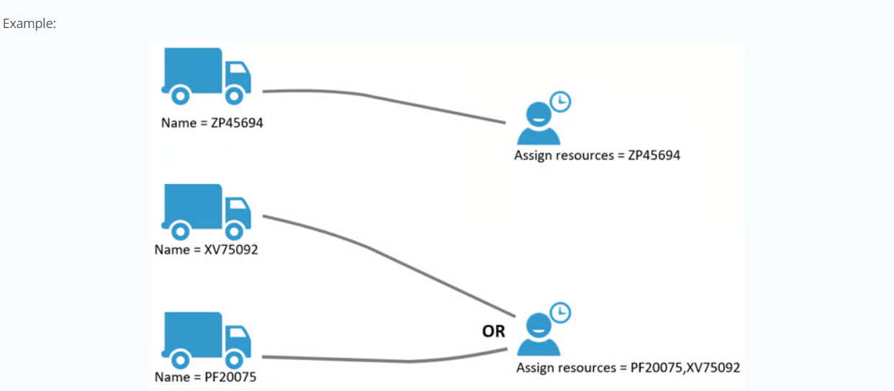

# Atribuir Recursos

Esta restrição permite que você **especificar quais recursos estão autorizados a visitar um site**. Os valores inseridos devem **corresponder aos valores de Nome** atribúidos a cada recurso.

**Formato:** Caractere, listado como **valores separados por vírgula** se especificar vários recursos.

**Exemplo:**

* Se apenas o Recurso A e o Recurso B estiverem autorizados a visitar um site, insira: Recurso A, Recurso B

<figure><figcaption></figcaption></figure>
